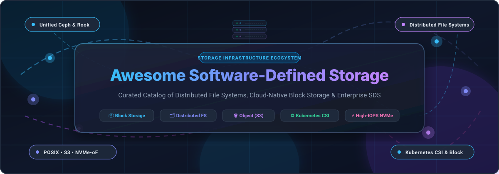

  

# 🚀 Awesome Software-Defined Storage (SDS)

  
  
  
  
  
  
  

---

## 📖 Executive Summary & Taxonomy

**Software-Defined Storage (SDS)** decouples data storage software from physical proprietary hardware controllers. By abstracting provisioning, data placement, replication, snapshots, and lifecycle policies into an autonomous software layer, SDS enables infrastructure architects to build resilient, hyper-scalable storage clusters utilizing standard commodity x86/ARM servers, NVMe flash arrays, and hybrid multi-cloud backends.

This repository is a rigorously curated index of enterprise-grade **Cloud/SaaS platforms** and production-tested **Open-Source GitHub projects** spanning **Distributed File Systems (POSIX/NFS/SMB)**, **High-IOPS Block Storage (CSI/iSCSI/NVMe-oF)**, and **Cloud-Native Object Storage (S3-compatible)**.

---

## 📑 Table of Contents

- [🌐 Sector Overview & Market Dynamics](#-sector-overview--market-dynamics)
- [☁️ Enterprise SaaS & Managed Cloud Storage Platforms](#️-enterprise-saas--managed-cloud-storage-platforms)
- [🛠️ Open-Source Software-Defined Storage Projects](#️-open-source-software-defined-storage-projects)
  - [Top Open-Source SDS Platforms (Ranked by Stars)](#top-open-source-sds-platforms-ranked-by-stars)
- [🧩 Architecture Selection Matrix](#-architecture-selection-matrix)
- [🤝 How to Contribute](#-how-to-contribute)
- [⭐ Star History](#-star-history)
- [💖 Support & Sponsoring](#-support--sponsoring)
- [⚖️ Disclaimer](#️-disclaimer)

---

## 🌐 Sector Overview & Market Dynamics

The global **Software-Defined Storage (SDS)** market is currently valued at approximately **$21.5 billion** and is projected to expand rapidly to over **$85.3 billion by 2030**, registering a compound annual growth rate (**CAGR of ~22.4%**).

The industry exhibits a **moderately fragmented market structure**: while hyperscale cloud providers (AWS, Microsoft Azure, Google Cloud) and established enterprise storage powerhouses (Dell Technologies, IBM, NetApp, Pure Storage) command significant market share for fully managed cloud-native implementations, the sector is not a winner-take-all monopoly. An active and dominant open-source ecosystem (anchored by Ceph, MinIO, Rook, OpenZFS, and JuiceFS) consistently drives industry standards, enabling hybrid-cloud portability and insulating modern engineering organizations from vendor lock-in.

---

## ☁️ Enterprise SaaS & Managed Cloud Storage Platforms

The following enterprise cloud-managed and software-defined storage platforms decouple capacity planning from physical appliances. Entries are sorted in **descending order by company size** (market capitalization / valuation).

| # | Product & Platform | Company & Market Size | Protocols & Architecture | Specific Starting Pricing | Free Tier / Trial Limits | Key Strengths & Use Cases |
| :-: | :--- | :--- | :--- | :--- | :--- | :--- |
| **1** | **[Azure Files](https://azure.microsoft.com/en-us/products/storage/files/)** | **Microsoft** 📊 ~$3.10T Market Cap *(FY24 Rev: $245.1B)* | Managed SMB 3.1.1, NFSv4.1, REST | **$0.06 / GB / month** *(Cool LRS tier; Hot: $0.15/GB/mo, Premium SSD: $0.16/GB/mo)* | **5 GB LRS storage/month free for 12 months** via Azure Free Account + $200 trial credit (30 days) | Fully managed cloud file shares with Azure Active Directory integration, soft delete, and seamless cross-region disaster recovery. |
| **2** | **[Google Cloud Filestore](https://cloud.google.com/filestore)** | **Alphabet / Google** 📊 ~$2.15T Market Cap *(FY24 Rev: $307.4B)* | Managed Cloud NFSv3, GKE CSI | **$0.16 / GB / month** *(Basic HDD: $163.84/TB/mo; Basic SSD: $0.20/GB/mo, Enterprise: $0.30/GB/mo)* | **90-day free trial with $300 credits** across GCP (sufficient to test ~1.8 TB-months of Filestore) | Low-latency cloud NAS with native Google Kubernetes Engine (GKE) CSI dynamic provisioning and multi-share enterprise scaling. |
| **3** | **[AWS EFS](https://aws.amazon.com/efs/)** | **Amazon / AWS** 📊 ~$1.95T Market Cap *(FY24 Rev: $574.8B)* | Elastic POSIX, NFSv4.0 & NFSv4.1 | **$0.16 / GB / month** *(One Zone Standard; Infrequent Access: $0.0133/GB/mo, Archive: $0.008/GB/mo)* | **5 GB / month free forever** under AWS Free Tier (Standard Storage class) | Serverless elastic file system automatically growing and shrinking with zero capacity pre-allocation; multi-AZ durability. |
| **4** | **[IBM Storage Scale](https://www.ibm.com/products/storage-scale)** | **IBM** 📊 ~$215B Market Cap *(FY24 Rev: $62.5B)* | High-Performance Clustered POSIX, NFS, S3 | **$0.18 / GB / month** *(Cloud VPC File Storage tier; Cloud-Kit software brings ~$51.80/core-month)* | **30-day developer trial license** (up to 12 TB storage limit) + $200 IBM Cloud welcome credit | World-renowned parallel cluster filesystem (formerly GPFS) powering world-class supercomputers and demanding AI training clusters. |
| **5** | **[Dell PowerScale for Multi-Cloud](https://www.dell.com/)** | **Dell Technologies** 📊 ~$85B Market Cap *(FY24 Rev: $88.4B)* | Multi-Cloud Scale-Out NAS (OneFS, S3, HDFS) | **$0.09 / GB / month** *(Through Sycomp/Faction multi-cloud managed subscription; node tiers from ~$3,500/mo)* | **30-day evaluation trial** on AWS/Azure Marketplace upon vendor architecture validation | Enterprise OneFS architecture directly interconnected to multiple public clouds with zero egress penalties between adjacent data links. |
| **6** | **[NetApp Cloud Volumes ONTAP](https://www.netapp.com/cloud/)** | **NetApp** 📊 ~$26B Market Cap *(FY24 Rev: $6.27B)* | Unified NAS & SAN (NFS, SMB, iSCSI) | **$0.10 / GB / month** *(PAYGO Explore software fee from $0.54/hr + raw underlying cloud disks)* | **500 GB capacity free forever** (Freemium license) + 30-day free trial on AWS/Azure/GCP marketplaces | Enterprise ONTAP data fabric delivering inline deduplication, compaction, zero-cost thin snapshots, and cross-cloud replication. |
| **7** | **[Pure Cloud Block Store](https://www.purestorage.com/)** | **Pure Storage** 📊 ~$18B Market Cap *(FY24 Rev: $2.83B)* | Cloud Block & NVMe-oF (Purity OS on Cloud) | **$0.15 / GB / month** *(Evergreen//One STaaS starting tier; CBS software licensing ~$0.50/TB-hour)* | **30-day free trial via Pure Test Drive** (interactive sandbox environment) + 30-day marketplace evaluation | Enterprise block storage with guaranteed deduplication, sub-millisecond cloud NVMe latency, and bidirectional hybrid replication. |
| **8** | **[Qumulo Cloud](https://qumulo.com/)** | **Qumulo** 📊 ~$1.2B Valuation *(Private Unicorn)* | Enterprise Cloud File Data (SMB, NFS, REST) | **$0.08 / GB / month** *(Azure Native Qumulo Cold Tier; Scalable Hot starts at $0.14/GB/mo; 1 TB minimum)* | **14-day free trial** with 1 TB capacity limit / $500 Marketplace consumption allowance | Exabyte-scale unified file system with real-time file-level telemetry, native cloud API automation, and high un-cached read bursts. |

---

## 🛠️ Open-Source Software-Defined Storage Projects

The open-source storage ecosystem provides hardware independence, zero vendor lock-in, and total operational transparency.

### Top Open-Source SDS Platforms (Ranked by Stars)

Each repository below is sorted in **descending order by GitHub Stars_Count**, with a real-time badge linking directly to the project's stargazers.

1. **[MinIO](https://github.com/minio/minio)**   
   **High-Performance Kubernetes-Native Object Storage** — The standard for S3-compatible cloud-native storage. Written in Go, MinIO delivers blazing performance (tens of GB/s per node), multi-tenant isolation, inline erasure coding, bitrot protection, and server-side encryption. Ideal for private cloud S3 APIs, AI/ML pipelines, and modern data lakes.

2. **[SeaweedFS](https://github.com/seaweedfs/seaweedfs)**   
   **Fast Distributed File, Object, and Key-Value Store** — Based on the Facebook Haystack design papers with an added Filer metadata layer. Handles billions of small files with constant O(1) disk read operations, POSIX filesystem mounts via FUSE, S3 API support, and cross-datacenter multi-master replication.

3. **[Ceph](https://github.com/ceph/ceph)**   
   **The Unified Distributed Storage Standard** — The most widely deployed enterprise open-source SDS platform in the world. Unifies three distinct interfaces over the RADOS cluster: **CephFS** (POSIX shared file system), **RBD** (scale-out block storage), and **RGW** (S3/Swift object gateway). CRUSH algorithm eliminates central lookup bottlenecks.

4. **[JuiceFS](https://github.com/juicedata/juicefs)**   
   **Cloud-Native POSIX File System Built on Redis/SQL & S3** — Decouples metadata storage (Redis, MySQL, PostgreSQL, TiKV) from data storage (any S3-compatible object storage). Delivers full POSIX compliance, transparent data caching, extreme concurrent file access, and Kubernetes CSI driver integration.

5. **[Rook](https://github.com/rook/rook)**   
   **Cloud-Native Storage Orchestrator for Kubernetes (CNCF Graduated)** — Turns Ceph and other distributed storage platforms into self-managing, self-scaling, and self-healing Kubernetes-native storage services with dynamic CSI volume provisioning.

6. **[OpenZFS](https://github.com/openzfs/zfs)**   
   **Advanced Enterprise File System and Volume Manager** — The foundational software storage engine underpinning TrueNAS, Proxmox, and enterprise storage arrays. Provides copy-on-write transactional semantics, pooled storage (zpools), snapshot trees, native encryption, and cryptographic checksumming against silent data corruption.

7. **[OpenEBS](https://github.com/openebs/openebs)**   
   **Container-Attached Storage (CAS) for Kubernetes (CNCF Project)** — Deploys dedicated storage controllers per workload pod. Offers local NVMe/SSD engines (Mayastor) with ultra-low latency, replicated high-availability volumes, and automated CSI snapshotting.

8. **[Longhorn](https://github.com/longhorn/longhorn)**   
   **Lightweight, Reliable Cloud-Native Distributed Block Storage (CNCF Incubating)** — Developed by SUSE Rancher. Implements micro-controllers per persistent volume with synchronous replication across Kubernetes nodes, built-in backup snapshots to secondary object storage, and automated volume expansion.

9. **[CubeFS](https://github.com/cubefs/cubefs)**   
   **Cloud-Native Distributed File and Object Storage (CNCF Project)** — Combines separate metadata, data, and object subsystems. Designed to bridge big data analytical workloads and containerized microservices across hybrid cloud clusters.

10. **[GlusterFS](https://github.com/gluster/glusterfs)**   
    **Scalable Network Cluster Filesystem** — Aggregates storage bricks into unified distributed and replicated volumes over TCP/IP or InfiniBand RDMA without a dedicated metadata server.

11. **[Storj](https://github.com/storj/storj)**   
    **Decentralized, Secure S3-Compatible Cloud Storage** — Encrypts, fragments, and distributes files across thousands of independent geographic nodes with automated Reed-Solomon erasure coding and zero-knowledge privacy.

12. **[Curve](https://github.com/opencurve/curve)**   
    **High-Performance Distributed Storage Engine (CNCF Sandbox)** — Built by NetEase. Delivers ultra-low latency block storage for virtual machines and databases, as well as an elastic shared file system for containerized AI computing clusters.

13. **[MooseFS](https://github.com/moosefs/moosefs)**   
    **Petabyte-Scale Fault-Tolerant Distributed POSIX Filesystem** — Pure C implementation featuring per-file configurable replication, directory project quotas, atomic snapshots, built-in file-level trash retention, and block device mapping (`mfsbdev`).

14. **[LINSTOR](https://github.com/LINBIT/linstor-server)**   
    **High-Performance Software-Defined Block Storage Orchestration** — Integrates DRBD replication with Linux LVM and ZFS to orchestrate replicated block devices across Kubernetes, OpenStack, Proxmox, and Docker with near bare-metal performance.

15. **[Sheepdog](https://github.com/sheepdog/sheepdog)**   
    **Distributed Block Storage for QEMU / KVM** — Autonomous replicated block device designed specifically for virtual machine images with thin provisioning, snapshotting, and cluster volume management.

16. **[LizardFS](https://github.com/lizardfs/lizardfs)**   
    **Highly Reliable Distributed File System** — Fork of MooseFS with multi-datacenter support, erasure coding, and advanced POSIX ACL integration.

17. **[DAOS](https://github.com/daos-stack/daos)**   
    **Distributed Asynchronous Object Storage (Linux Foundation)** — Next-generation storage stack optimized from the ground up for NVMe-oF and persistent memory (PMEM), offering extreme microsecond-range latency for HPC and AI simulation workloads.

18. **[BeeGFS](https://github.com/ThinkParQ/beegfs)**   
    **Parallel Clustered File System for High-Performance Computing (HPC)** — Features distributed client striping, separate metadata targets, native InfiniBand/Omni-Path RDMA, and on-demand burst-buffer clustering (BeeOND).

19. **[ZapFS](https://github.com/LeeDigitalWorks/zapfs)**   
    **Open-Core Distributed Object Storage** — S3-compatible object platform featuring Raft consensus managers, relational metadata engines, and multi-tenant access control policies.

---

## 🧩 Architecture Selection Matrix

Choosing the right Software-Defined Storage technology depends on workload I/O characteristics and infrastructure topology:

| Use Case Category | Primary Requirements | Recommended Open-Source | Recommended Managed SaaS |
| :--- | :--- | :--- | :--- |
| **Kubernetes Container Storage (CSI)** | Dynamic PV provisioning, ReadWriteOnce/Many, low latency | **Rook (Ceph)**, **Longhorn**, **OpenEBS** | **Google Cloud Filestore**, **Azure Files** |
| **Private S3 Object Storage & Data Lakes** | High-throughput GET/PUT, erasure coding, IAM policies | **MinIO**, **SeaweedFS**, **Ceph RGW** | **AWS S3 / EFS**, **Cloudian** |
| **High-Performance Computing (HPC) & AI** | RDMA, POSIX compliance, extreme parallel IOPS | **BeeGFS**, **DAOS**, **JuiceFS** | **IBM Storage Scale**, **Dell PowerScale** |
| **General Purpose Scalable NAS** | POSIX file shares, quota management, snapshots | **MooseFS**, **CephFS**, **JuiceFS** | **AWS EFS**, **Azure Files**, **NetApp ONTAP** |
| **High-IOPS SAN / VM Block Devices** | Direct raw block mapping, sub-millisecond latency | **LINSTOR (DRBD)**, **Ceph RBD**, **OpenZFS** | **Pure Cloud Block Store**, **AWS EBS** |

---

## 🤝 How to Contribute

Contributions from storage engineers, platform developers, and open-source advocates are always welcome!

1. 🍴 **Fork the repository** on GitHub.
2. 🌿 **Create a dedicated topic branch** (`git checkout -b feature/add-storage-engine`).
3. 📝 **Add or update entries** in `README.md` keeping formatting consistent (include name, repo/site link, specific pricing/Stars_Badges, and concise architecture notes).
4. 🧪 **Verify all links and markdown rendering**.
5. 🚀 **Submit a Pull Request** with a brief summary of the changes.

---

## ⭐ Star History

---

## 💖 Support & Sponsoring

If you find this curated directory of Software-Defined Storage platforms useful in your infrastructure research, architecture designs, or production deployments, please consider supporting the project:

- ⭐ **Star this repository** to boost discoverability and help fellow infrastructure engineers.
- 🍴 **Fork and contribute** updates, benchmarks, and new SDS entries.
- 📢 **Share with your team**, DevOps networks, and cloud infrastructure communities.
- ☕ **Sponsor the maintainer**: Buy a coffee or support ongoing development on the [GitHub Sponsors Dashboard](https://github.com/sponsors/ishandutta2007).

---

## ⚖️ Disclaimer

- This catalog is a community-curated, independent index and does not represent an endorsement of any commercial product or vendor.
- Performance, pricing, and operational complexity vary greatly depending on network fabric (RDMA vs. Ethernet), storage media (NVMe, SSD, HDD), and node configuration. Always conduct independent bench testing (e.g., with `fio`, `vdbench`, or `COSBench`) prior to production rollout.
- Distributed replication protects against physical hardware failure, not against accidental deletion, file corruption, or security breaches. Always implement isolated offline backups and snapshot retention schedules.

---

  <b>Built with ❤️ for storage architects, DevOps engineers, and cloud infrastructure teams worldwide.</b>

